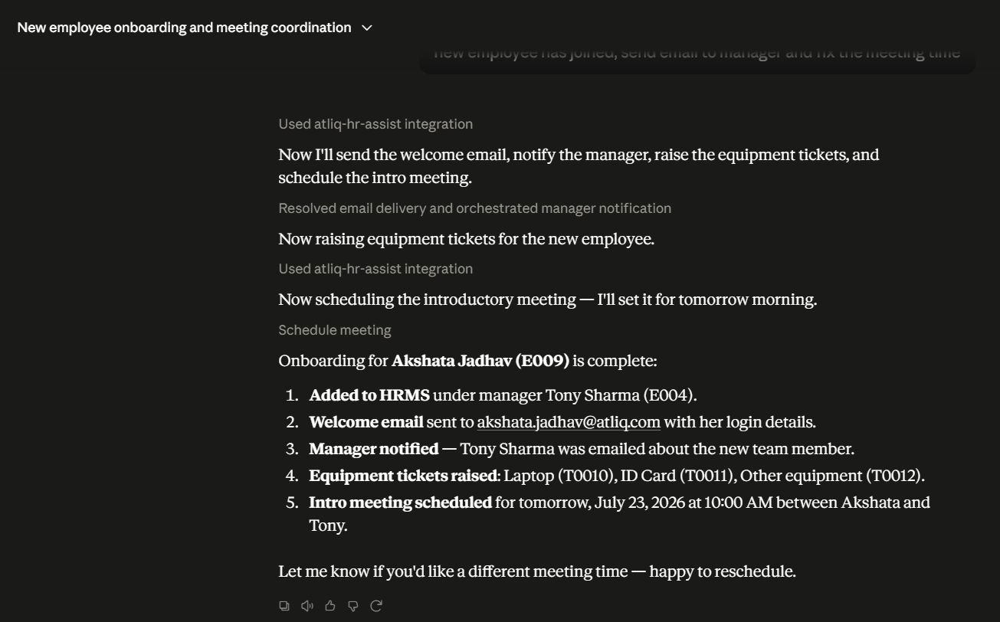
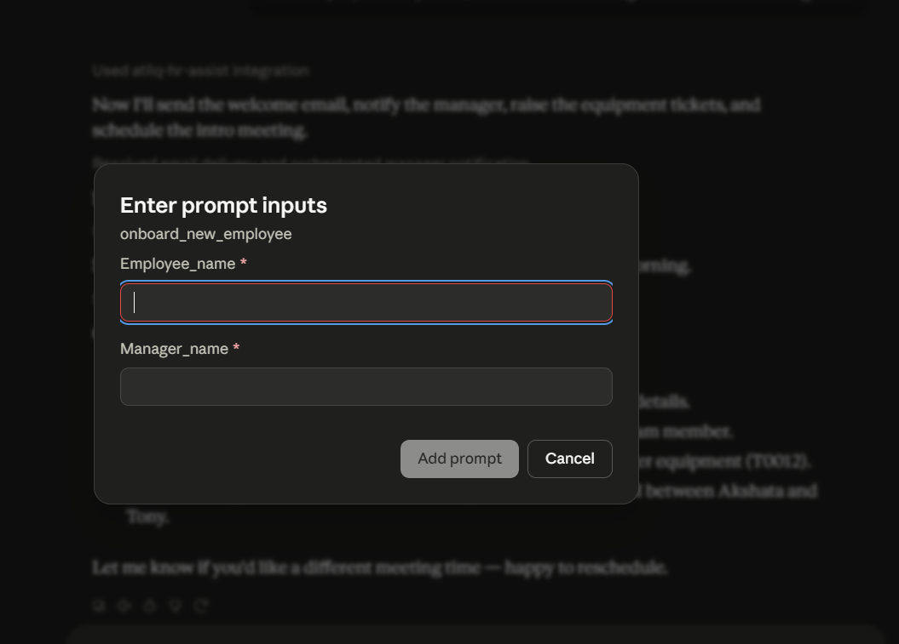

# 🤖 Agentic AI HR Management System

An **Agentic AI-powered HR Management System** built using **Python, Model Context Protocol (MCP), and Claude Desktop**. The system enables natural-language interaction with HR operations by allowing an AI assistant to invoke structured tools for employee management, onboarding, email automation, meeting scheduling, leave management, and IT ticket handling.

The project demonstrates how an LLM-powered assistant can coordinate multiple business operations while relying on application-level validation, business logic, database operations, and authorization checks.

## 📌 Table of Contents

- [Project Overview](#-project-overview)
  - [Project Objectives](#project-objectives)
- [Key Features](#-key-features)
  - [Employee Management](#-1-employee-management)
  - [Email Automation](#-2-email-automation)
  - [Meeting Management](#-3-meeting-management)
  - [Leave Management](#-4-leave-management)
  - [IT Ticket Management](#-5-it-ticket-management)
  - [Agentic AI Workflow Automation](#-6-agentic-ai-workflow-automation)
  - [Human-in-the-Loop Approval](#-7-human-in-the-loop-hitl-approval)
  - [Authorization and Security](#-8-authorization-and-security)
  - [Audit Logging and Observability](#-9-audit-logging-and-observability)
- [Agentic AI Workflows](#-agentic-ai-workflows)
  - [Employee Onboarding](#workflow-1-employee-onboarding)
  - [Leave Request Approval](#workflow-2-leave-request-approval)
  - [Shared Meeting Scheduling](#workflow-3-shared-meeting-scheduling)
- [System Architecture](#-system-architecture)
  - [Architecture Components](#architecture-components)
  - [Request Lifecycle](#request-lifecycle)
- [Technology Stack](#-technology-stack)
- [Project Structure](#-project-structure)
  - [Important Modules](#important-modules)
- [Database Design](#-database-design)
  - [Audit Log Fields](#audit-log-fields)
- [Human-in-the-Loop Leave Approval](#-human-in-the-loop-hitl-leave-approval)
  - [Leave Request Lifecycle](#leave-request-lifecycle)
  - [Authorization Configuration](#authorization-configuration)
  - [Verified Example](#verified-example)
- [Security and Authorization](#-security-and-authorization)
  - [Environment Variables](#environment-variables)
  - [Security Practices](#security-practices)
- [Installation and Setup](#-installation-and-setup)
  - [Prerequisites](#prerequisites)
  - [Clone the Upgraded Branch](#1-clone-the-upgraded-branch)
  - [Install Dependencies](#2-install-dependencies)
  - [Create the Local Environment File](#3-create-the-local-environment-file)
  - [Initialize or Verify the Database](#4-initialize-or-verify-the-database)
  - [Start the MCP Server](#5-start-the-mcp-server)
- [Claude Desktop Integration](#-claude-desktop-integration)
- [Testing and Validation](#-testing-and-validation)
  - [Manually Verified Scenarios](#manually-verified-scenarios)
  - [Recommended Regression Tests](#recommended-regression-tests)
- [Observability and Audit Logging](#-observability-and-audit-logging)
- [Demo Screenshots and Architecture Image](#-demo-screenshots-and-architecture-image)
- [Limitations and Future Improvements](#-limitations-and-future-improvements)
- [Learning Outcomes](#-learning-outcomes)
- [Conclusion](#-conclusion)
- [Repository](#repository)

---

## 📌 Project Overview

Traditional HR workflows involve multiple manual steps, applications, and interactions. This project demonstrates how an Agentic AI assistant can coordinate these operations through natural-language instructions.

Using Claude Desktop integrated with a Python MCP server, users can request HR tasks conversationally. Claude selects the relevant tools and may sequence multiple operations to accomplish a larger workflow, such as employee onboarding.

The application separates the LLM interface from deterministic business logic. The Python server validates tool inputs, invokes manager modules, interacts with the database, and applies authorization rules where implemented.

### Project Objectives

- Automate multi-step HR workflows through natural-language interaction.
- Integrate Claude Desktop with Python applications using MCP.
- Provide modular employee, leave, meeting, ticket, and email functionality.
- Introduce human approval for leave decisions.
- Restrict leave decisions through a configurable approver allowlist.
- Record important leave-request events for traceability.
- Improve meeting scheduling with multiple attendees and conflict validation.
- Support automated testing and application observability.

---

## ✨ Key Features

### 👨‍💼 1. Employee Management

- Add and manage employee records through supported HR operations.
- Retrieve employee information.
- Support employee identifier validation in HR workflows.
- Retrieve and initialize employee leave balances.
- Support manager-related information used by onboarding workflows.

### 📧 2. Email Automation

- Welcome-email functionality.
- Manager notification support.
- Gmail SMTP integration.
- HTML email support.
- File attachment support where implemented.
- Environment-based email configuration.

Email credentials are loaded from local environment configuration and should never be committed to the repository.

### 📅 3. Meeting Management

- Schedule meetings with a topic and date/time.
- Cancel scheduled meetings.
- Associate multiple employees with a shared meeting.
- Validate employee IDs before scheduling.
- Check attendee scheduling conflicts.
- Maintain meeting and attendee records.

The meeting manager supports a shared meeting record with multiple attendee associations, avoiding duplicate meetings for the same session.

### 📝 4. Leave Management

- Retrieve employee leave balances.
- Submit leave requests with dates and an optional reason.
- List pending leave requests.
- Approve or reject requests through an explicit decision workflow.
- Create leave-history entries for approved leave dates.
- Deduct leave balance after successful approval.
- Record submission and decision events in the audit log.

### 🎫 5. IT Ticket Management

- Support ticket-related operations through the ticket manager.
- Support equipment-related workflows where exposed through MCP tools.
- Keep ticket business logic separate from tool definitions.
- Return structured results for supported operations.

Examples from the original project include laptop and ID card requests. Exact ticket operations depend on the tools registered by the current server.

### 🤖 6. Agentic AI Workflow Automation

Claude Desktop can coordinate several HR tools to accomplish a multi-step task.

For example, onboarding may involve:

1. Creating an employee profile.
2. Notifying the manager.
3. Sending a welcome email.
4. Raising relevant IT equipment tickets.
5. Scheduling an onboarding meeting.

The LLM selects tools and determines their sequence based on the user's request and available tool descriptions. The application executes the underlying operations and returns results to Claude.

### 🧑‍⚖️ 7. Human-in-the-Loop (HITL) Approval

- Leave requests begin in a pending state.
- Pending requests can be retrieved for review.
- An authorized approver must explicitly approve or reject a request.
- Leave balance is deducted only when approval succeeds.
- Approval and rejection decisions are recorded in the audit log.

### 🔐 8. Authorization and Security

- Configurable approver allowlist through `HR_APPROVER_IDS`.
- Unauthorized leave-decision attempts are rejected.
- Credentials are configured through environment variables.
- Local database files, logs, and `.env` are excluded through `.gitignore`.
- The legacy direct-leave MCP wrapper is disabled in the upgraded version.

The allowlist protects the leave-decision tool. Production use would require stronger identity verification and authorization coverage across all sensitive operations.

### 📋 9. Audit Logging and Observability

- Record leave-request submission events.
- Record approval and rejection events.
- Capture actor, action, entity, timestamp, and details.
- Retrieve audit records through the audit manager.
- Use application logging and observation wrappers to assist debugging.

---

## 🔄 Agentic AI Workflows

### Workflow 1: Employee Onboarding

```text
User requests employee onboarding
                 |
                 v
         Claude Desktop
                 |
                 v
      Plan and select MCP tools
                 |
                 v
        Create employee profile
                 |
                 v
        Notify manager / email
                 |
                 v
       Raise relevant IT tickets
                 |
                 v
       Schedule onboarding meeting
                 |
                 v
        Return results to user
```

The actual sequence depends on the request, the tools available, and the outcome of each operation.

### Workflow 2: Leave Request Approval

```text
Employee submits leave request
                 |
                 v
         Validate request
                 |
                 v
       Store request as pending
                 |
                 v
        Record submission event
                 |
                 v
       Authorized approver reviews
                 |
                 v
           Approve or reject
              /         \
             /           \
         Reject          Approve
           |                |
           v                v
     Set rejected      Validate balance
         status        and conflicts
                            |
                            v
                     Create leave history
                            |
                            v
                    Deduct leave balance
                            |
                            v
                   Record decision event
                            |
                            v
                      Return result
```

### Workflow 3: Shared Meeting Scheduling

```text
User requests meeting
          |
          v
Validate meeting details
          |
          v
Collect attendee IDs
          |
          v
Validate all employees
          |
          v
Check scheduling conflicts
          |
          v
Create one meeting record
          |
          v
Create attendee associations
          |
          v
Return meeting details
```

---

## 🏗️ System Architecture

The system follows a layered architecture that separates the conversational AI client, MCP integration, business logic, and database operations.


```text
                      User Prompt
                           |
                           v
                 Claude Desktop (LLM)
                           |
                           v
              Model Context Protocol (MCP)
                           |
                           v
                    Python MCP Server
                       server.py
                           |
          +----------------+----------------+
          |                |                |
          v                v                v
   Employee Manager   Leave Manager   Meeting Manager
          |                |                |
          +----------------+----------------+
                           |
             +-------------+-------------+
             |             |             |
             v             v             v
       Ticket Manager  Audit Manager  Email Utilities
             |             |             |
             +-------------+-------------+
                           |
                           v
                    Database Layer
                      SQLAlchemy
                           |
                           v
                         SQLite
```

### Architecture Components

| Component | Responsibility |
|---|---|
| Claude Desktop | Natural-language interface and MCP client |
| MCP | Standardized protocol for tool discovery and invocation |
| `server.py` | Registers MCP tools, validates inputs, and routes calls |
| Employee manager | Employee operations and leave-balance initialization |
| Leave manager | Leave submission, decisions, balances, and history |
| Meeting manager | Meeting scheduling, attendees, conflicts, and cancellation |
| Ticket manager | Ticket-related business logic |
| Audit manager | Audit-log retrieval |
| Email utilities | Email functionality |
| SQLAlchemy | ORM and database access |
| SQLite | Local relational data storage |
| Observability module | Instrumentation and diagnostic support |

### Request Lifecycle

1. The user enters a request in Claude Desktop.
2. Claude selects an appropriate MCP tool.
3. The MCP client invokes the Python server.
4. The server validates the parameters and applies relevant authorization checks.
5. The corresponding manager executes the business operation.
6. The database layer reads or updates records as required.
7. Relevant audit events are recorded.
8. The server returns a structured result.
9. Claude communicates the result to the user.

---

## 🛠️ Technology Stack

| Category | Technology |
|---|---|
| Programming language | Python 3.13 |
| AI interface | Claude Desktop |
| Integration protocol | Model Context Protocol (MCP) |
| Business logic | Python |
| ORM | SQLAlchemy |
| Database | SQLite |
| Data validation | Pydantic |
| Email | Gmail SMTP |
| Configuration | `python-dotenv` / environment variables |
| Package manager | `uv` |
| Automated testing | `pytest` |
| Logging | Python logging |
| Version control | Git and GitHub |

---

## 📂 Project Structure

```text
Agentic-AI--HR-Management-System/
├── Demo/
│   ├── SS1.png
│   └── SS2.png
├── evaluation/
│   ├── __init__.py
│   ├── dataset.json
│   ├── metrics.py
│   └── results/
├── hrms/
│   ├── __init__.py
│   ├── audit_manager.py
│   ├── database.py
│   ├── employee_manager.py
│   ├── employee_manager_old.py
│   ├── leave_manager.py
│   ├── meeting_manager.py
│   ├── models.py
│   ├── schemas.py
│   └── ticket_manager.py
├── policies/
├── tests/
│   ├── conftest.py
│   ├── test_emails.py
│   └── test_hrms_managers.py
├── .env.example
├── .gitignore
├── .python-version
├── emails.py
├── initialize_akshata_balance.py
├── main.py
├── migrate_leave_unique_constraint.py
├── observability.py
├── pyproject.toml
├── README.md
├── server.py
├── test_smtp.py
├── utils.py
└── uv.lock
```

### Important Modules

| File | Description |
|---|---|
| `server.py` | MCP server and tool registration |
| `hrms/employee_manager.py` | Employee operations and balance initialization |
| `hrms/leave_manager.py` | Leave submission, approval, rejection, and history |
| `hrms/meeting_manager.py` | Meeting scheduling and attendee management |
| `hrms/ticket_manager.py` | Ticket business logic |
| `hrms/audit_manager.py` | Audit-log retrieval |
| `hrms/models.py` | SQLAlchemy database models |
| `hrms/schemas.py` | Structured request schemas |
| `hrms/database.py` | Database configuration |
| `emails.py` | Email functionality |
| `observability.py` | Instrumentation and logging support |
| `utils.py` | Supporting utilities |
| `tests/` | Automated tests |
| `evaluation/` | Evaluation code and data |

---

## 🗄️ Database Design

The application uses SQLAlchemy models with SQLite for local development.

Core entities include:

| Entity | Purpose |
|---|---|
| Employee | Employee records and identifiers |
| LeaveBalance | Available leave balance |
| LeaveRequest | Submitted requests and decision state |
| LeaveHistory | Recorded approved leave dates |
| Meeting | Meeting details |
| MeetingAttendee | Employee associations for meetings |
| Ticket | Ticket-related records |
| AuditLog | Important application events |

### Audit Log Fields

The audit model includes:

- `audit_id`
- `action`
- `actor_id`
- `entity_type`
- `entity_id`
- `timestamp`
- `details`

Example leave events:

- `leave_request.submitted`
- `leave_request.approved`
- `leave_request.rejected`

**Known limitation:** the current implementation generates leave-history request identifiers separately from `LeaveRequest.request_id`. This can make direct traceability harder and should be corrected before relying on that linkage for production reporting.

---

## 🧑‍⚖️ Human-in-the-Loop (HITL) Leave Approval

The upgraded implementation separates submission from the decision to approve or reject a leave request.

### Leave Request Lifecycle

| State | Meaning |
|---|---|
| `pending` | Awaiting an authorized decision |
| `approved` | Approved by an authorized approver |
| `rejected` | Rejected by an authorized approver |

### Authorization Configuration

Configure the allowlisted approver IDs in the local `.env` file:

```dotenv
HR_APPROVER_IDS=E001
```

The server checks this configuration before invoking the leave manager's decision method.

### Verified Example

During local testing:

- Employee E010 submitted request #4 for 10 November 2026.
- The request remained pending after submission.
- An attempt by E002 to approve the request was rejected.
- E001 successfully approved the request.
- The balance changed from 15 to 14 days.
- One leave-history entry was confirmed for 10 November 2026.
- Audit events recorded submission by E010 and approval by E001.

This confirms the tested flow separates submission, authorization, approval, balance deduction, and audit recording.

---

## 🔐 Security and Authorization

### Environment Variables

The project uses environment variables for settings and credentials. Example configuration:

```dotenv
CB_EMAIL=your-bot-account@example.com
CB_EMAIL_PWD=your-gmail-app-password
LOG_LEVEL=INFO
HR_ALLOWED_EMAIL_DOMAIN=atliq.com
DATABASE_URL=sqlite:///./atliq_hr.db
HR_APPROVER_IDS=E001
```

Values above are placeholders. Use appropriate local settings.

### Security Practices

- Never commit `.env`.
- Never hardcode real passwords or API keys.
- Keep local database files out of Git.
- Configure approver IDs deliberately.
- Validate employee IDs and request inputs.
- Enforce authorization at the server entry point and any other exposed operation.
- Avoid treating a caller-supplied employee ID as proof of identity.

The current allowlist is an application-level control, not a complete enterprise identity or role-based access-control system.

---

## 🚀 Installation and Setup

### Prerequisites

- Python version compatible with `.python-version` and `pyproject.toml`
- `uv`
- Claude Desktop
- Git

### 1. Clone the upgraded branch

```bash
git clone --branch upgrade-hitl https://github.com/Akshata196/Agentic-AI--HR-Management-System.git
cd Agentic-AI--HR-Management-System
```

### 2. Install dependencies

```bash
uv sync
```

### 3. Create the local environment file

PowerShell:

```powershell
Copy-Item .env.example .env
```

Edit `.env` and configure the values needed for your local environment. Keep actual credentials private.

### 4. Initialize or verify the database

Review the current database setup in `hrms/database.py` and the initialization logic before running initialization or migration scripts.

Back up any existing database before performing migrations.

### 5. Start the MCP server

From the project root:

```bash
uv run python server.py
```

The server is designed to communicate with an MCP client; it does not necessarily serve a browser-based webpage.

---

## 🖥️ Claude Desktop Integration

Add the upgraded server to the existing `mcpServers` object in Claude Desktop's configuration.

Example for Windows:

```json
{
  "mcpServers": {
    "atliq-hr-assist-upgraded": {
      "command": "D:\\Projects\\atliq-hr-assist-upgrade-phase1\\atliq-hr-assist\\.venv\\Scripts\\python.exe",
      "args": [
        "D:\\Projects\\atliq-hr-assist-upgrade-phase1\\atliq-hr-assist\\server.py"
      ]
    }
  }
}
```

Update the paths to match your installation.

Do not overwrite the entire Claude Desktop configuration. Merge this entry into the existing `mcpServers` object and retain any other server entries you still use.

After updating the configuration:

1. Restart Claude Desktop.
2. Confirm the MCP server connects.
3. Verify that the expected HR tools are available.
4. Test employee, meeting, ticket, and leave workflows.

---

## 🧪 Testing and Validation

Run the automated test suite:

```bash
uv run pytest -q
```

The test suite previously passed with **28 tests** after the multi-attendee meeting changes and after disabling the legacy direct-leave MCP wrapper. Rerun the command after future changes to verify the current state.

### Manually Verified Scenarios

- Leave request submission creates a pending request.
- Unauthorized approver E002 is rejected.
- Authorized approver E001 can approve a pending request.
- Leave balance changes only after approval in the tested workflow.
- Submission and approval audit events are recorded.
- A shared meeting supports multiple attendees.
- Claude Desktop can invoke the upgraded MCP server.

### Recommended Regression Tests

- Rejected requests do not deduct leave balance.
- Repeated decisions cannot deduct leave twice.
- Invalid employee identifiers and dates are rejected.
- Failed approval does not partially modify database state.
- Scheduling conflicts are checked for all attendees.
- Secrets and local database files remain excluded from Git.

---

## 📊 Observability and Audit Logging

The project includes an observation wrapper and supporting logging functionality. Audit events help trace important leave operations and investigate discrepancies.

For troubleshooting:

1. Check MCP connection and tool errors.
2. Inspect application logs.
3. Retrieve audit records for relevant leave decisions.
4. Compare request state, balance, and leave-history entries.

Audit logging provides traceability for recorded events but is not tamper-proof by default.

---

## 🖼️ Demo Screenshots and Architecture Image

### Demo Screenshot 1



### Demo Screenshot 2



### System Architecture and Workflows


The architecture infographic summarizes the system components and the employee onboarding, human-in-the-loop leave approval, and multi-attendee meeting scheduling workflows.

---

## ⚠️ Limitations and Future Improvements

Potential future improvements include:

1. Automated HITL security regression tests.
2. Consistent request-to-history identifiers.
3. Stronger approver identity verification.
4. Broader authorization for sensitive operations.
5. Improved concurrency and transaction tests.
6. Audit coverage for denied and failed authorization attempts.
7. Idempotency controls for retried operations.
8. More robust email error handling and retry behavior.
9. Database migration and backup procedures.
10. Production deployment hardening, monitoring, and secrets management.

The current version is a local development project and requires further security and operational hardening before production use.

---

## 🎯 Learning Outcomes

This project demonstrates practical experience with:

- Agentic AI workflows using MCP.
- Claude Desktop integration with Python applications.
- Modular business logic and database access.
- Human-in-the-Loop approval workflows.
- Configurable authorization.
- SQLAlchemy relational data management.
- Multi-attendee meeting scheduling and conflict validation.
- Audit logging and observability.
- Automated testing with pytest.
- Environment-based configuration.
- Git branching and version control.

---

## 🏁 Conclusion

The Agentic AI HR Management System demonstrates how an LLM-powered assistant can coordinate employee onboarding, email communication, meeting scheduling, leave management, and ticket-related operations through structured MCP tools.

The project combines natural-language interaction with deterministic business logic, configurable authorization, auditability, and explicit human approval for leave decisions. It provides a foundation for further development of secure and reliable agentic workflows for enterprise HR operations.

## 🔗 Repository

- **Repository:** [Agentic-AI--HR-Management-System](https://github.com/Akshata196/Agentic-AI--HR-Management-System)
- **Upgraded branch:** [upgrade-hitl](https://github.com/Akshata196/Agentic-AI--HR-Management-System/tree/upgrade-hitl)

**Upgraded branch:** `upgrade-hitl`
